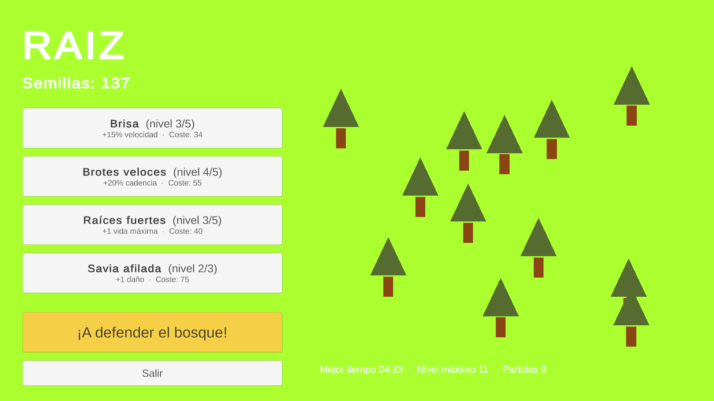
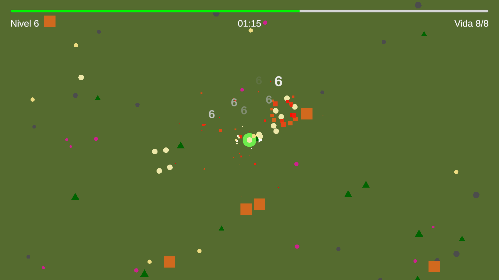
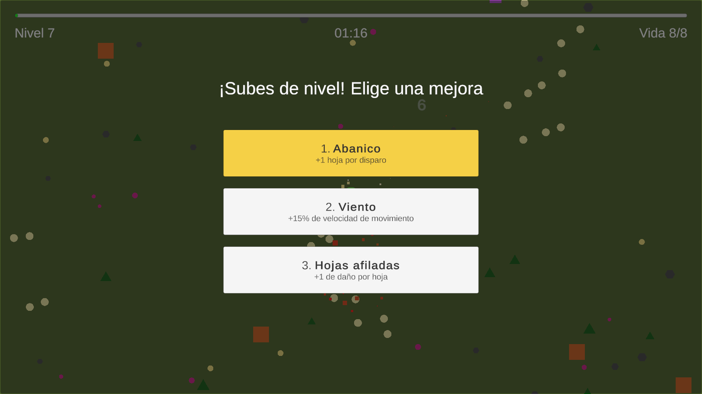
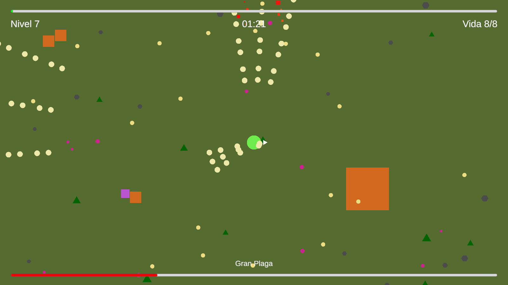

# 🌱 RAÍZ

**[Español](#español) · [English](#english)**

   

| | |
|---|---|
|  |  |
|  |  |

---

## Español

**RAÍZ** es un juego 2D de acción y supervivencia (género *roguelite / survivors*) hecho en **Unity 6** y **C#**.

Eres un pequeño espíritu del bosque que protege el último árbol del mundo de oleadas de plagas cada vez más numerosas. Las plagas sueltan semillas: con ellas subes de nivel durante la partida y, al terminar, **haces crecer tu bosque** con mejoras permanentes que te hacen más fuerte en la siguiente.

### 🎮 Descargar y jugar
1. Ve a **[Releases](../../releases/latest)** y descarga `RAIZ-v1.0-Windows.zip`.
2. Descomprímelo y ejecuta `RAIZ.exe`.

> Windows puede mostrar el aviso *"Windows protegió su PC"* porque el juego no tiene firma digital comercial (es habitual en juegos independientes). Pulsa **Más información → Ejecutar de todas formas**.

### ⌨️ Controles
| Acción | Tecla |
|---|---|
| Moverse / apuntar (8 direcciones) | **WASD** o **flechas** |
| Disparar (mantener = ráfaga) | **Espacio** (también clic izquierdo o Enter) |
| Navegar por los menús | **Flechas / WASD** + **Enter** |
| Elegir mejora al subir de nivel | **1, 2, 3** o flechas + Enter |
| Fin de partida: reintentar / volver al bosque | **R** / **B** |

### ✨ Características
- **Combate en 8 direcciones** con disparo manual y flecha indicadora.
- **Subida de nivel con elección de 1 de 3 mejoras** al azar (disparo más rápido, más daño, abanico de hojas, velocidad, vida).
- **Oleadas crecientes** definidas por datos: nuevos tipos de enemigo aparecen con el tiempo.
- **Jefe** con máquina de estados (perseguir → avisar → embestir), anuncio y barra de vida.
- **Bosque permanente**: las semillas se guardan entre partidas y se invierten en mejoras; por cada mejora crece un árbol.
- **Sensación de impacto (*game feel*)**: temblor de pantalla por "trauma", *hit stop*, partículas, números de daño flotantes y sonidos con variación de tono.
- **Guardado** de progreso y récords en JSON.
- **Todos los menús se pueden usar solo con teclado.**

### 🛠️ Aspectos técnicos
- **Arquitectura por componentes**: piezas pequeñas y reutilizables (`Health`, `DropOnDeath`, `ImpactFeedback`, `HealthSounds`…) que se combinan en el Inspector. Por ejemplo, `DropOnDeath` sirve tanto para soltar semillas como para crear partículas.
- **Eventos C#** (`event Action`) para desacoplar sistemas: la vida avisa y la interfaz, los sonidos o la pantalla de fin reaccionan sin conocerse entre sí.
- **ScriptableObjects** para el contenido: mejoras de partida, mejoras permanentes y un catálogo único que usan la tienda y el jugador.
- **Diseño guiado por datos**: la dificultad se ajusta con una lista de reglas de aparición (`SpawnRule`) en el Inspector, sin tocar código.
- **Prefab Variants** para los tipos de enemigo (Oruga, Escarabajo, Jefe heredan de Plaga).
- **Persistencia** con `JsonUtility` y `System.IO`, con protección ante archivos dañados.
- **Generación reproducible** del bosque con `System.Random` y semilla fija, y *Sorting Groups* para el orden de dibujo.
- **Input System** de Unity con acciones (las teclas se cambian sin tocar código) y navegación de interfaz con `EventSystem`.
- **Script de editor** (`Assets/Editor/BuildGame.cs`) para exportar el juego con un clic o desde línea de comandos.
- **Capturas automáticas** (`ScreenshotDirector`): con `RAIZ.exe -capturas <carpeta>` el juego se juega solo y genera las imágenes de este README.

### 📁 Estructura
```
Assets/
├── Scenes/            Bosque (menú y tienda) · SampleScene (partida)
├── Scripts/
│   ├── Player/        movimiento, disparo, experiencia, muerte
│   ├── Enemies/       persecución, generador de oleadas, jefe
│   ├── Combat/        vida, daño, proyectiles, sensación de impacto
│   ├── Forest/        mejoras permanentes, tienda y bosque
│   ├── Save/          guardado en JSON
│   ├── UI/            HUD, menús, números de daño
│   ├── Camera/        seguimiento, temblor, hit stop
│   ├── Audio/         gestor de sonido
│   ├── Pickups/       semillas
│   └── World/         decorado del suelo
├── Prefabs/           enemigos, proyectiles, partículas, decorado
├── Mejoras/           mejoras de partida (ScriptableObjects)
├── MejorasPermanentes/ mejoras del bosque (ScriptableObjects)
└── Editor/            herramienta de exportación
```

### ▶️ Abrir el proyecto
1. Instala **Unity 6.6** (6000.6.3f1) con Unity Hub.
2. Clona el repositorio y ábrelo desde Unity Hub (*Add project from disk*).
3. Abre `Assets/Scenes/Bosque.unity` y pulsa **Play**.

### 📚 Qué he aprendido
Este es mi primer juego completo en Unity, hecho como proyecto de aprendizaje después de terminar el ciclo de **Desarrollo de Aplicaciones Multiplataforma (DAM)**. Con él he trabajado el ciclo de vida de los componentes de Unity, la física 2D, la interfaz de usuario, la organización de un proyecto con Git, la separación entre datos y lógica, y el *game feel*. Mi siguiente paso es seguir haciendo juegos pequeños y participar en *game jams*.

### 🙏 Créditos
- Desarrollo: **SergioA4M**
- Efectos de sonido: [Kenney](https://kenney.nl) — *Interface Sounds* e *Impact Sounds* (licencia CC0)
- Motor: [Unity](https://unity.com)

---

## English

**RAÍZ** (Spanish for *"root"*) is a 2D action survival game (*roguelite / survivors-like*) made with **Unity 6** and **C#**.

You play as a small forest spirit protecting the world's last tree from ever-growing waves of pests. Pests drop seeds: during a run they level you up, and after each run you **grow your forest** with permanent upgrades that make you stronger next time.

### 🎮 Download and play
1. Go to **[Releases](../../releases/latest)** and download `RAIZ-v1.0-Windows.zip`.
2. Unzip it and run `RAIZ.exe`.

> Windows may show a *"Windows protected your PC"* warning because the game is not commercially code-signed (common for indie games). Click **More info → Run anyway**.

### ⌨️ Controls
| Action | Key |
|---|---|
| Move / aim (8 directions) | **WASD** or **arrow keys** |
| Shoot (hold = burst) | **Space** (also left click or Enter) |
| Navigate menus | **Arrows / WASD** + **Enter** |
| Pick an upgrade on level up | **1, 2, 3** or arrows + Enter |
| Game over: retry / back to the forest | **R** / **B** |

### ✨ Features
- **8-directional combat** with manual shooting and a direction indicator.
- **Level-up choices**: pick 1 of 3 random upgrades (fire rate, damage, spread shot, speed, health).
- **Data-driven escalating waves**: new enemy types join over time.
- **Boss** with a state machine (chase → telegraph → charge), announcement and health bar.
- **Persistent forest**: seeds are banked between runs and spent on upgrades; every upgrade grows a new tree.
- **Game feel**: trauma-based screen shake, hit stop, particles, floating damage numbers and pitch-varied sound effects.
- **Save system** for progress and records (JSON).
- **Every menu is fully keyboard-navigable.**

### 🛠️ Technical highlights
- **Component-based architecture**: small reusable pieces (`Health`, `DropOnDeath`, `ImpactFeedback`, `HealthSounds`…) combined in the Inspector. For example, `DropOnDeath` spawns both seeds and particle effects.
- **C# events** (`event Action`) to decouple systems: health raises events and the UI, audio or game-over screen react without knowing each other.
- **ScriptableObjects** for content: run upgrades, permanent upgrades and a single catalog shared by the shop and the player.
- **Data-driven design**: difficulty is tuned through a list of spawn rules (`SpawnRule`) in the Inspector, with no code changes.
- **Prefab Variants** for enemy types (Caterpillar, Beetle and Boss inherit from Pest).
- **Persistence** with `JsonUtility` and `System.IO`, resilient to corrupted files.
- **Reproducible forest generation** with a seeded `System.Random`, plus *Sorting Groups* for draw order.
- Unity **Input System** actions (rebindable without code) and UI navigation through the `EventSystem`.
- **Editor script** (`Assets/Editor/BuildGame.cs`) to build the game in one click or from the command line.
- **Automated screenshots** (`ScreenshotDirector`): running `RAIZ.exe -capturas <folder>` makes the game play itself and produce the images in this README.

### ▶️ Opening the project
1. Install **Unity 6.6** (6000.6.3f1) through Unity Hub.
2. Clone this repository and open it from Unity Hub (*Add project from disk*).
3. Open `Assets/Scenes/Bosque.unity` and press **Play**.

### 📚 What I learned
This is my first complete Unity game, built as a learning project after finishing a vocational degree in **Multiplatform Application Development (DAM)**. It covered Unity's component lifecycle, 2D physics, UI, project organization with Git, separating data from logic, and game feel. Next, I plan to keep building small games and join game jams.

### 🙏 Credits
- Development: **SergioA4M**
- Sound effects: [Kenney](https://kenney.nl) — *Interface Sounds* and *Impact Sounds* (CC0 license)
- Engine: [Unity](https://unity.com)
